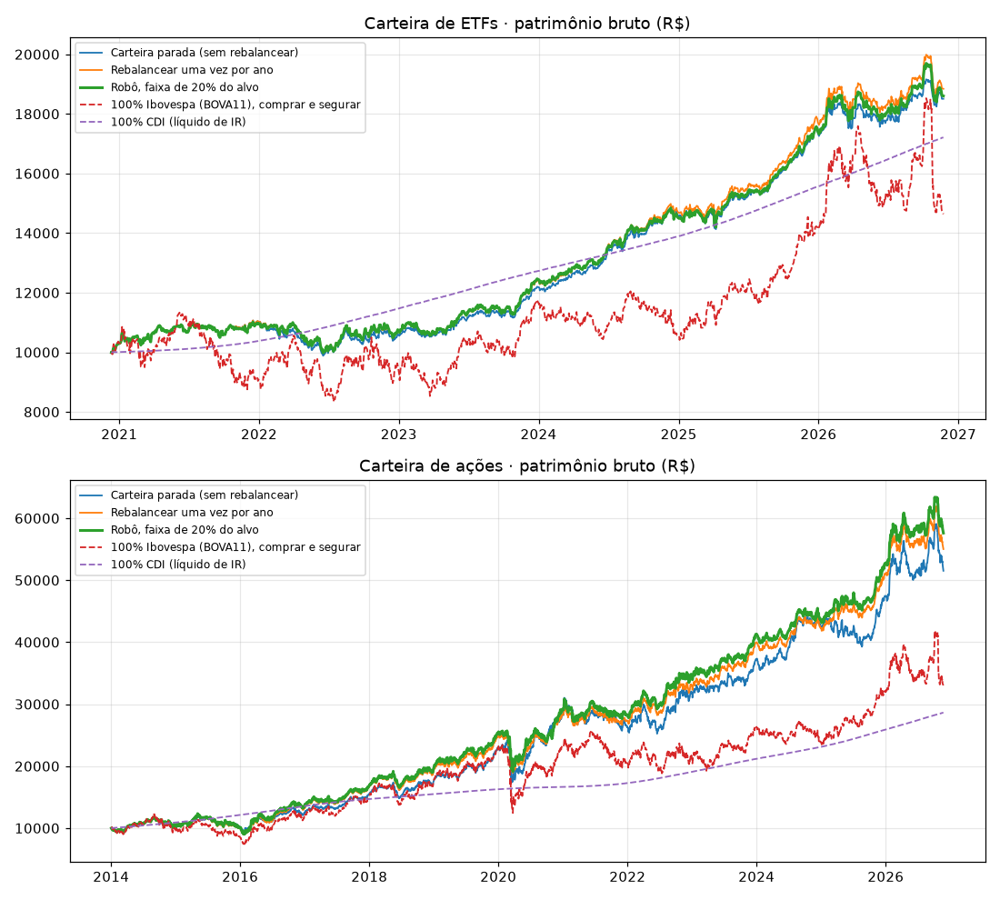

# Resultado do backtest · 25/11/2026

Gerado automaticamente pelo GitHub Actions (`backtest/simulador.py`).

Capital: R$ 10.000. Custos: 0,13% por operação (B3 + diferença de preço). CDI de 02/01/2014 a 23/11/2026, com 15% de IR sobre o rendimento do caixa.
Valores **líquidos**: no fim de cada período a carteira é vendida e o IR devido é descontado, para que a carteira parada não leve vantagem por adiar o imposto.



## Carteira de ETFs

Alvo: BOVA11 35%, IVVB11 25%, GOLD11 10% e caixa 30% no CDI.
Dados de 11/12/2020 a 23/11/2026 (1479 pregões).

Retorno total líquido de custos e IR (anual · queda máxima · operações)

| Estratégia | Completo 2020–2026 | Validação 2021–2026 |
|---|---|---|
| Carteira parada (sem rebalancear) | +76% (+10% a.a. · −11% · 0) | +70% (+9% a.a. · −10% · 0) |
| Rebalancear todo mês | +79% (+10% a.a. · −10% · 78) | +75% (+10% a.a. · −9% · 78) |
| Rebalancear a cada 3 meses | +82% (+11% a.a. · −9% · 45) | +77% (+10% a.a. · −9% · 44) |
| Rebalancear uma vez por ano | +80% (+10% a.a. · −10% · 13) | +75% (+10% a.a. · −9% · 13) |
| Robô, faixa de 20% do alvo | +77% (+10% a.a. · −9% · 7) | +71% (+10% a.a. · −10% · 7) |
| Robô, faixa de 35% do alvo | +77% (+10% a.a. · −11% · 2) | +71% (+10% a.a. · −10% · 1) |
| 100% Ibovespa (BOVA11), comprar e segurar | +39% (+6% a.a. · −26% · 0) | +36% (+5% a.a. · −26% · 0) |
| 100% CDI (líquido de IR) | +72% (+10% a.a. · −0% · 0) | +72% (+10% a.a. · −0% · 0) |

IR pago no período completo: robô 20% R$ 107, anual R$ 150, mensal R$ 224. Custos de negociação: robô R$ 13, mensal R$ 26.

## Carteira de ações

Alvo: ITUB4 10%, VALE3 10%, PETR4 10%, WEGE3 10%, EGIE3 10%, ABEV3 10%, BBSE3 10% e caixa 30% no CDI.
Dados de 02/01/2014 a 23/11/2026 (3206 pregões).

Retorno total líquido de custos e IR (anual · queda máxima · operações)

| Estratégia | Completo 2014–2026 | Calibração 2014–2020 | Validação 2021–2026 |
|---|---|---|---|
| Carteira parada (sem rebalancear) | +361% (+13% a.a. · −28% · 0) | +158% (+15% a.a. · −28% · 0) | +97% (+12% a.a. · −15% · 0) |
| Rebalancear todo mês | +448% (+14% a.a. · −26% · 711) | +174% (+16% a.a. · −26% · 337) | +96% (+12% a.a. · −11% · 235) |
| Rebalancear a cada 3 meses | +436% (+14% a.a. · −27% · 281) | +164% (+15% a.a. · −27% · 129) | +99% (+12% a.a. · −11% · 116) |
| Rebalancear uma vez por ano | +418% (+14% a.a. · −27% · 80) | +163% (+15% a.a. · −27% · 40) | +94% (+12% a.a. · −11% · 30) |
| Robô, faixa de 20% do alvo | +450% (+14% a.a. · −27% · 135) | +176% (+16% a.a. · −27% · 83) | +93% (+12% a.a. · −11% · 37) |
| Robô, faixa de 35% do alvo | +418% (+14% a.a. · −27% · 41) | +159% (+15% a.a. · −27% · 23) | +88% (+11% a.a. · −11% · 9) |
| 100% Ibovespa (BOVA11), comprar e segurar | +195% (+9% a.a. · −47% · 0) | +113% (+11% a.a. · −47% · 0) | +36% (+5% a.a. · −26% · 0) |
| 100% CDI (líquido de IR) | +186% (+9% a.a. · −0% · 0) | +66% (+8% a.a. · −0% · 0) | +72% (+10% a.a. · −0% · 0) |

IR pago no período completo: robô 20% R$ 0, anual R$ 0, mensal R$ 0. Custos de negociação: robô R$ 106, mensal R$ 183.

## Limitações

- **Viés de sobrevivência na carteira de ações:** as ações foram escolhidas hoje, sabendo que sobreviveram e continuam grandes. O resultado passado delas tende a parecer melhor do que seria.
- Preço ajustado do Yahoo: dividendos reinvestidos sem imposto; o IR de 15% sobre JCP não foi descontado.
- Diferença de preço no fracionário estimada; em ações menos líquidas pode ser maior.
- É um único caminho histórico. A ordem entre as estratégias pode mudar em outro período.

## Como reproduzir
```
cd backtest
python dados.py dados                # cotações (Yahoo) e CDI (Banco Central)
python simulador.py dados resultado
```
